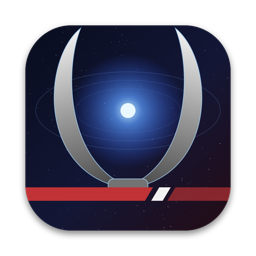
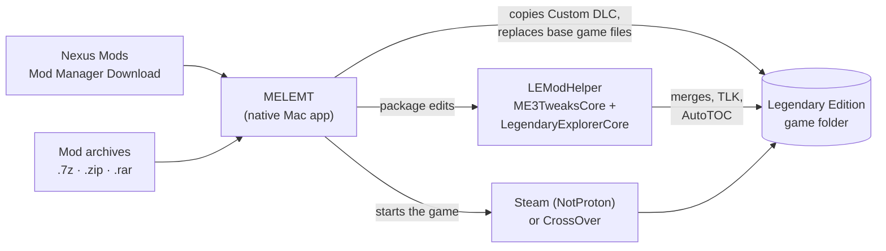

<p align="center">
  
</p>

<h1 align="center">MELEMT</h1>

<p align="center">
  <strong>Mass Effect Legendary Edition Mod Tool</strong><br>
  A native Mac app for installing, managing and playing Mass Effect Legendary Edition mods.
</p>

<p align="center">
  <a href="https://github.com/kfalencik/MELEMT/releases/latest"></a>
  
  <a href="LICENSE"></a>
</p>

---

Mass Effect Legendary Edition runs on a Mac through Steam with NotProton, or through CrossOver, but its mods are made for **ME3Tweaks Mod Manager**, which is Windows-only. MELEMT brings that mod support to macOS as a native app. It installs the same mods the same way, so you can play the Legendary Edition modded without a Windows PC.

## What you can do

### Install mods the way they're meant to be installed
- **One-click installs from Nexus Mods.** Click **Mod Manager Download** on a mod's page and MELEMT downloads and installs it.
- **Drop in any mod archive** (`.7z`, `.zip`, `.rar`) or folder, or just save it to your Downloads folder and MELEMT picks it up.
- **Full ME3Tweaks mod support:** Custom DLC, base game file replacements, merge mods, text (TLK) merges, 2DA, Coalesced and PlotManager merges, and texture overrides.
- **Install options** for mods with choices, laid out the way the mod's author set them up, with descriptions and pictures.
- **Required mods handled for you.** If a mod needs another one first, MELEMT tells you which and offers to get it.

### Keep your games healthy
- **Sets each game up to load mods** automatically, including the mod loader and the ASI plugins mods rely on.
- **Backs up every original game file** before changing it, so you can always undo.
- **Rebuild Mods** puts the original files back and reinstalls everything in load order, which fixes most problems.
- **Turn mods off and on**, uninstall them (they go to the Trash), and see when a newer version is out on Nexus Mods.

### Play
- **Start any of the three games** straight from MELEMT, through Steam (NotProton) or CrossOver.
- **Launcher Mode** (View ▸ Launcher Mode, ⇧⌘L) hides everything except the three games and their Play buttons, so MELEMT doubles as a clean game launcher.
- **Game settings** such as language, voice-over and subtitles, plus selected config options for each game.
- **Your own artwork:** choose a custom cover and banner for each game in its settings, like Steam's custom artwork. You can reset to the default any time.

### Stay up to date
- **MELEMT updates itself.** New versions are offered automatically, or use **MELEMT ▸ Check for Updates…**

## Download

1. Download **MELEMT-x.y.zip** from the [latest release](https://github.com/kfalencik/MELEMT/releases/latest).
2. Unzip it and drag **MELEMT.app** to your Applications folder.
3. Open it. MELEMT looks for your game automatically. If it can't find it, point it at your **Mass Effect Legendary Edition** folder.
4. Optional: connect your Nexus Mods account so **Mod Manager Download** buttons send mods straight to MELEMT.

**Requirements**
- macOS 26 (Tahoe) or later on an Apple silicon Mac
- Mass Effect Legendary Edition from Steam, running through Steam + NotProton or Steam in a [CrossOver](https://www.codeweavers.com/crossover) bottle (see [Setting up the game](#setting-up-the-game) below)

MELEMT is signed and notarized by Apple, so it opens without security warnings.

## Setting up the game

Mass Effect Legendary Edition is a Windows game, so it needs a compatibility layer to run on a Mac. Either of these setups works with MELEMT. Both need [CrossOver](https://www.codeweavers.com/crossover), which is paid software with a free trial.

### Option 1: Steam for Mac + NotProton (recommended)

[NotProton](https://github.com/NotProtonNot/NotProton) lets the normal Mac Steam app run Windows games, using CrossOver behind the scenes. You keep one Steam library, and the game installs like any other.

1. Install **CrossOver 26.3** (or a CrossOver Preview build that NotProton supports; check [NotProton's page](https://github.com/NotProtonNot/NotProton) for the current list). You don't need to create a bottle.
2. Install [Steam for Mac](https://store.steampowered.com/about/) and sign in.
3. Install **NotProton** from its [releases page](https://github.com/NotProtonNot/NotProton/releases), or with Homebrew:
   ```sh
   brew install --cask notprotonnot/notproton/notproton
   ```
4. Open NotProton and follow its setup. From then on, open Steam through NotProton (MELEMT does this for you when you press Play).
5. In Steam, go to **Settings ▸ Compatibility** and choose the CrossOver (Rosetta) compatibility tool as the default, as NotProton recommends.
6. Install **Mass Effect Legendary Edition**. The default Steam library or a library on another drive both work, but the drive can't be NTFS-formatted (NotProton doesn't support NTFS).
7. Start the game once from Steam. The EA app opens the first time; sign in with your EA account and let it link to Steam. Wait for the Legendary Edition launcher to appear, then quit.

### Option 2: Steam inside a CrossOver bottle

1. Install [CrossOver](https://www.codeweavers.com/crossover).
2. In CrossOver, choose **Install a Windows Application**, search for **Steam**, and install it. CrossOver creates a bottle for it.
3. Open Steam from that bottle, sign in, and install **Mass Effect Legendary Edition**. To use another drive, add a library in Steam's **Settings ▸ Storage**.
4. Start the game once from Steam. The EA app opens the first time; sign in with your EA account and let it link to Steam. Wait for the Legendary Edition launcher to appear, then quit.

### Then open MELEMT

MELEMT looks for the game in Steam for Mac's libraries, Steam libraries at the top of any connected drive, and inside CrossOver bottles. If it doesn't find yours, choose the **Mass Effect Legendary Edition** folder yourself (the one that contains the `Game` folder).

If you have both setups, choose which one starts the games in MELEMT's **Settings ▸ Playing ▸ Start games with**.

## How it works



- **Reading mods.** Every ME3Tweaks-format mod has a `moddesc.ini` that describes what it installs and which options it has. MELEMT reads it and follows the same rules as ME3Tweaks Mod Manager.
- **Installing.** Simple steps, such as copying Custom DLC folders and replacing files, happen in the app itself. Steps that edit the game's package files (merge mods, text merges, config merges and AutoTOC) are done by **LEModHelper**. This bundled command-line tool is built from ME3TweaksCore and LegendaryExplorerCore, the same libraries ME3Tweaks Mod Manager uses, so the results match what you'd get on Windows.
- **Loading mods in game.** The Legendary Edition only loads mods with a signature bypass and ASI loader in place. MELEMT installs those, plus the AutoTOC and LE1 Autoload Enabler plugins, and the Visual C++ runtime that Wine setups often lack.
- **Undo.** Before any original game file is changed for the first time, a copy is saved in `~/Library/Application Support/LEModManager/Backups`. **Restore Original Game Files**, **Rebuild Mods** and **Remove All Mods** use those copies.
- **Compatibility with Windows.** Mods are marked the way ME3Tweaks Mod Manager marks them (`_metacmm.txt`), so a game folder modded with MELEMT is still recognized by ME3Tweaks Mod Manager.

## FAQ

**Do I need ME3Tweaks Mod Manager or Windows?**
No. MELEMT does the installing itself on your Mac.

**Will it work with mods from Nexus Mods?**
Yes, with any mod made for ME3Tweaks Mod Manager (it has a `moddesc.ini`), which covers most Legendary Edition mods. Mods that use install steps MELEMT doesn't support yet are refused with a message, rather than half-installed.

**How do I get back to an unmodded game?**
Use **Remove All Mods** on the game's page. For a completely fresh copy, use **Verify Integrity of Game Files** in Steam.

**Where are my mods kept?**
Downloads go to `LEModManager/Downloads` inside your Legendary Edition folder, so large mods stay on the same drive as the game rather than filling up your Mac's internal drive.

## Building from source

Requirements: Xcode 27, the [.NET 10 SDK](https://dot.net) in `~/.dotnet`, and [Rust](https://rustup.rs) in `~/.cargo`.

```sh
git clone https://github.com/kfalencik/MELEMT.git
cd MELEMT
Helper/fetch-sources.sh   # ME3TweaksCore, LegendaryExplorerCore and oozextract, with the macOS patches
Helper/build-helper.sh    # builds MEMT/Helper/LEModHelper
open MEMT.xcodeproj
```

LEModHelper's source is in `Helper/LEModHelper`, and the small macOS fixes to the upstream libraries are in `Helper/patches`.

<details>
<summary><strong>Releasing a new version</strong></summary>

One-time setup:

1. A **Developer ID Application** certificate in your login keychain.
2. Notarization credentials: `xcrun notarytool store-credentials MELEMT --apple-id <you> --team-id 37KPZYVX63`
3. The Sparkle signing key in your login keychain (account `MELEMT`). Keep a backup with
   `generate_keys --account MELEMT -x melemt-sparkle-key.txt`. Without it you can't ship updates to existing users.
4. `gh auth login`

Then commit your changes and run:

```sh
scripts/release.sh 1.1 notes.md
```

The script builds and signs the app, has Apple notarize it, publishes the GitHub release, and adds the update to `appcast.xml` so installed copies offer it.

</details>

## Credits

- [ME3TweaksCore](https://github.com/ME3Tweaks/ME3TweaksCore) and [LegendaryExplorerCore](https://github.com/ME3Tweaks/LegendaryExplorer) by ME3Tweaks (GPL-3.0). The signature bypass, AutoTOC and LE1 Autoload Enabler files also come from ME3Tweaks. Huge thanks to the ME3Tweaks team, whose work makes Legendary Edition modding possible.
- [oozextract](https://github.com/lvlvllvlvllvlvl/oozextract) (MIT) for Oodle decompression.
- [Sparkle](https://sparkle-project.org) (MIT) for updates.
- Microsoft Visual C++ runtime, redistributed for the game's ASI plugins.

MELEMT isn't affiliated with or endorsed by BioWare, Electronic Arts or ME3Tweaks. Mass Effect is a trademark of EA International (Studio and Publishing) Ltd.

## License

MELEMT is free software under the [GPL-3.0](LICENSE) license.
